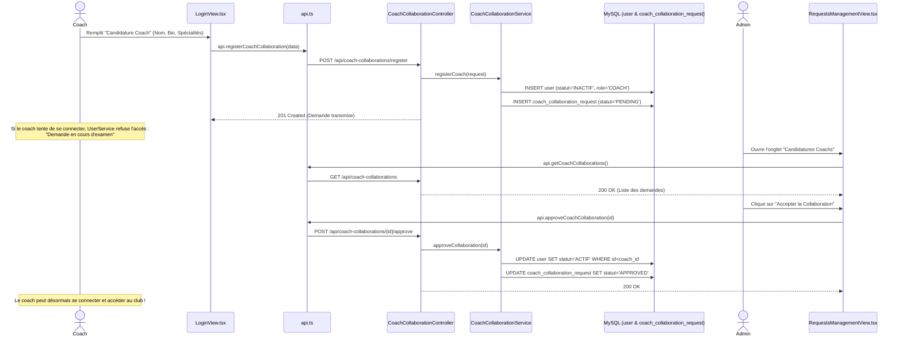
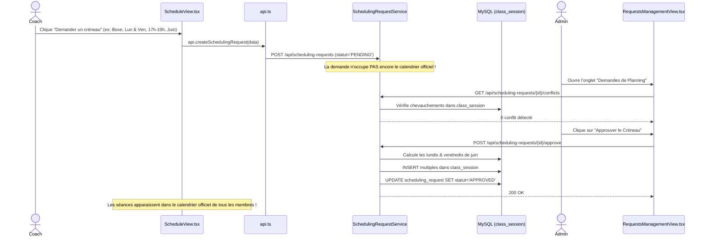
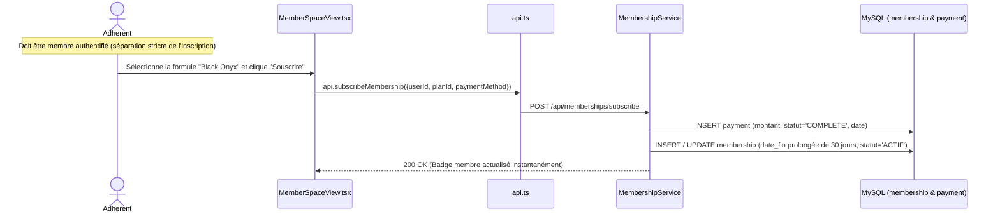

# Guide Complet d'Architecture et de Fonctionnement
## Projet Fédérateur : Plateforme Fullstack de Gestion de Salle de Sport — HADID Byrsa
**École Nationale d'Ingénieurs de Carthage (ENICarthage)**  
*Binôme de développement : Aymen Zahmoul (Lead Architect ~65%) & Aziz (Domain & Features Developer ~35%)*

---

## 1. Fiche d'Identité du Projet

| Propriété | Détail Technique |
| :--- | :--- |
| **Nom de l'application** | HADID Byrsa Sanctuary — Gym Management System |
| **Architecture** | Architecture en couches (*Layered / N-Tier Architecture*) découplée |
| **Backend** | Java 21 LTS pur (*Native `HttpServer` sans Spring Boot*) |
| **Persistance & BDD** | MySQL 8.x via JDBC natif (`mysql-connector-j-8.0.33`) |
| **Sérialisation** | Google Gson 2.10.1 (avec adaptateurs personnalisés `LocalDate` & `LocalDateTime`) |
| **Frontend** | React 19 + TypeScript + Vite 8 + Tailwind CSS + Framer Motion |
| **Ports réseau** | Backend API : `http://localhost:8081` \| Frontend Vite : `http://localhost:5173` \| MySQL : `3306` |
| **Rôles utilisateurs** | `ADMIN` (Gestion totale & approbations), `COACH` (Planning & demandes), `ADHERENT` (Abonnements & séances) |

---

## 2. Architecture Globale & Flux de Données

L'application respecte rigoureusement le modèle en couches étanche : aucune couche ne saute d'étape.

```
+---------------------------------------------------------------------------------------+
|                                    NAVIGATEUR CLIENT                                  |
|   Composants React (App.tsx, ScheduleView.tsx, RequestsManagementView.tsx, etc.)      |
+-------------------------------------------+-------------------------------------------+
                                            |
                         Appels HTTP Fetch typés (JSON)
                                            |
                                            v
+---------------------------------------------------------------------------------------+
|                         COUCHE CLIENT FRONTEND (src/services/api.ts)                  |
|   Fonctions exportées : api.getSessions(), api.createSchedulingRequest(), etc.        |
+-------------------------------------------+-------------------------------------------+
                                            |
                                 HTTP REST (Port 8081)
                                            |
                                            v
+---------------------------------------------------------------------------------------+
|                                  SERVEUR HTTP JAVA NATIF                              |
|   1. ApiServer.java : Ecoute sur le port 8081, gère le thread pool                    |
|   2. Router.java    : Intercepte la requête, gère CORS, extrait paramètres et route   |
+-------------------------------------------+-------------------------------------------+
                                            |
                                     Dispatch vers
                                            |
                                            v
+---------------------------------------------------------------------------------------+
|                         COUCHE CONTROLLER (tn.enicarthage.gym.controller)             |
|   Reçoit HttpExchange, lit le corps JSON (via Gson), appelle le Service, renvoie 200/400 |
+-------------------------------------------+-------------------------------------------+
                                            |
                                    Appel de méthode
                                            |
                                            v
+---------------------------------------------------------------------------------------+
|                          COUCHE SERVICE (tn.enicarthage.gym.service)                  |
|   Logique métier pure : validations, détection de conflits horaires, règles de statut |
+-------------------------------------------+-------------------------------------------+
                                            |
                                 Opérations CRUD / Requêtes
                                            |
                                            v
+---------------------------------------------------------------------------------------+
|                            COUCHE DAO (tn.enicarthage.gym.dao)                        |
|   Data Access Object : Exécute le SQL PreparedStatement, mappe ResultSet -> Model    |
+-------------------------------------------+-------------------------------------------+
                                            |
                               Obtention de la Connection
                                            |
                                            v
+---------------------------------------------------------------------------------------+
|                     SINGLETON JDBC (tn.enicarthage.gym.config.DatabaseConnection)     |
|   Gère le DriverManager MySQL et fournit les instances java.sql.Connection           |
+-------------------------------------------+-------------------------------------------+
                                            |
                                            v
+---------------------------------------------------------------------------------------+
|                               BASE DE DONNÉES MYSQL (gym_management)                  |
|   Tables : user, gym, class_session, scheduling_request, coach_collaboration, etc.    |
+---------------------------------------------------------------------------------------+
```

---

## 3. Le Backend Java Natif : Couche par Couche

### 3.1. Connexion JDBC : `DatabaseConnection.java`
* **Localisation** : [`backend/src/main/java/tn/enicarthage/gym/config/DatabaseConnection.java`](file:///C:/Users/ASUS/Desktop/projet/gym_fullstack/backend/src/main/java/tn/enicarthage/gym/config/DatabaseConnection.java)
* **Rôle** : Implémente le pattern **Singleton**. Fournit une méthode statique synchronisée `getConnection()` qui charge le driver `com.mysql.cj.jdbc.Driver` et établit la liaison avec `jdbc:mysql://localhost:3306/gym_management`.
* **Pratique clé** : Toutes les requêtes DAO utilisent le pattern `try-with-resources` (`try (Connection conn = DatabaseConnection.getConnection(); PreparedStatement stmt = ...)`) pour garantir la fermeture immédiate des connexions et éviter les fuites mémoire.

### 3.2. Couche DAO (Data Access Object) : `tn.enicarthage.gym.dao`
* **Rôle** : Isoler totalement le code SQL du reste du système. Chaque entité métier possède son DAO dédié.
* **Fonctionnement interne** :
  1. Reçoit des paramètres métiers Java.
  2. Prépare une requête `PreparedStatement` sécurisée contre les injections SQL (placeholders `?`).
  3. Exécute la requête (`executeQuery()` ou `executeUpdate()`).
  4. Mappe les colonnes du `ResultSet` (`rs.getString()`, `rs.getTimestamp()`, etc.) vers les objets POJO de la couche `model`.
* **Inventaire des DAOs** :
  * [`UserDAO.java`](file:///C:/Users/ASUS/Desktop/projet/gym_fullstack/backend/src/main/java/tn/enicarthage/gym/dao/UserDAO.java) : Authentification (`findByEmail`), gestion adhérents et coachs.
  * [`CoachCollaborationRequestDAO.java`](file:///C:/Users/ASUS/Desktop/projet/gym_fullstack/backend/src/main/java/tn/enicarthage/gym/dao/CoachCollaborationRequestDAO.java) : Candidatures coachs, historique et mise à jour de statut (`PENDING`, `APPROVED`, `REJECTED`).
  * [`SchedulingRequestDAO.java`](file:///C:/Users/ASUS/Desktop/projet/gym_fullstack/backend/src/main/java/tn/enicarthage/gym/dao/SchedulingRequestDAO.java) : Demandes récurrentes de créneaux par les coachs.
  * [`SessionDAO.java`](file:///C:/Users/ASUS/Desktop/projet/gym_fullstack/backend/src/main/java/tn/enicarthage/gym/dao/SessionDAO.java) : Séances effectives du calendrier (`class_session`), recherche de créneaux par salle et heure.
  * [`BookingDAO.java`](file:///C:/Users/ASUS/Desktop/projet/gym_fullstack/backend/src/main/java/tn/enicarthage/gym/dao/BookingDAO.java) : Réservations des membres et décrémentation des places.
  * [`MembershipDAO.java`](file:///C:/Users/ASUS/Desktop/projet/gym_fullstack/backend/src/main/java/tn/enicarthage/gym/dao/MembershipDAO.java) : Validité et contrats d'adhésion.
  * [`MembershipPlanDAO.java`](file:///C:/Users/ASUS/Desktop/projet/gym_fullstack/backend/src/main/java/tn/enicarthage/gym/dao/MembershipPlanDAO.java) : Grille tarifaire (Silver, Black Onyx, Titanium).
  * [`PaymentDAO.java`](file:///C:/Users/ASUS/Desktop/projet/gym_fullstack/backend/src/main/java/tn/enicarthage/gym/dao/PaymentDAO.java) : Grand livre financier et audit de caisse.
  * [`GymDAO.java`](file:///C:/Users/ASUS/Desktop/projet/gym_fullstack/backend/src/main/java/tn/enicarthage/gym/dao/GymDAO.java) & [`FitnessClassDAO.java`](file:///C:/Users/ASUS/Desktop/projet/gym_fullstack/backend/src/main/java/tn/enicarthage/gym/dao/FitnessClassDAO.java) : Données structurelles des clubs et des disciplines.

### 3.3. Modèles (`model/`) vs DTOs (`dto/`)
* **Modèles Métier ([`tn.enicarthage.gym.model`](file:///C:/Users/ASUS/Desktop/projet/gym_fullstack/backend/src/main/java/tn/enicarthage/gym/model))** :
  * Représentent les tables réelles de la base de données.
  * Exemples : `User`, `ClassSession`, `SchedulingRequest`, `CoachCollaborationRequest`, `Payment`.
* **DTOs (Data Transfer Objects) ([`tn.enicarthage.gym.dto`](file:///C:/Users/ASUS/Desktop/projet/gym_fullstack/backend/src/main/java/tn/enicarthage/gym/dto))** :
  * Définissent le contrat strict d'échange réseau avec le client web.
  * Permettent de ne jamais exposer d'informations sensibles (ex: hash de mot de passe absent de `MemberResponse`).
  * Exemples : `LoginRequest`, `CoachRegisterRequest`, `BookingRequest`, `SessionRequest`, `DashboardStats`.

### 3.4. Couche Service : `tn.enicarthage.gym.service`
* **Rôle** : Le **cœur décisionnel et algorithmique** de l'application. Ne manipule pas directement de SQL, mais orchestre les DAOs.
* **Règles métier majeures implémentées** :
  * [`SchedulingRequestService.java`](file:///C:/Users/ASUS/Desktop/projet/gym_fullstack/backend/src/main/java/tn/enicarthage/gym/service/SchedulingRequestService.java) :
    * Moteur de détection de conflits : vérifie si un créneau récurrent chevauche une séance existante dans la même salle ou avec le même coach.
    * Générateur de calendrier : lors de l'approbation d'une demande par l'admin, calcule toutes les dates récurrentes entre la date de début et de fin, et insère automatiquement les séances dans `class_session`.
  * [`CoachCollaborationService.java`](file:///C:/Users/ASUS/Desktop/projet/gym_fullstack/backend/src/main/java/tn/enicarthage/gym/service/CoachCollaborationService.java) :
    * Inscription sécurisée d'un coach avec statut `INACTIF` et création de sa demande de collaboration.
    * L'approbation par l'administrateur active le compte coach (`ACTIF`) et l'affilie officiellement à la salle.
  * [`UserService.java`](file:///C:/Users/ASUS/Desktop/projet/gym_fullstack/backend/src/main/java/tn/enicarthage/gym/service/UserService.java) :
    * Authentification : bloque la connexion des coachs tant que leur demande est `PENDING` avec un message clair.
  * [`PaymentService.java`](file:///C:/Users/ASUS/Desktop/projet/gym_fullstack/backend/src/main/java/tn/enicarthage/gym/service/PaymentService.java) & [`MembershipService.java`](file:///C:/Users/ASUS/Desktop/projet/gym_fullstack/backend/src/main/java/tn/enicarthage/gym/service/MembershipService.java) :
    * Validation stricte des paiements en ligne : synchronise la création du reçu financier et prolonge l'abonnement du membre.

### 3.5. Couche Controller : `tn.enicarthage.gym.controller`
* **Rôle** : Pont de communication HTTP.
* **Mécanique** :
  1. Reçoit l'objet `HttpExchange` natif de Java.
  2. Extrait les paramètres de requête ou désérialise le corps JSON reçu via Gson.
  3. Délègue l'exécution à la couche Service.
  4. Sérialise le résultat en JSON avec le code HTTP adapté (200 OK, 201 Created, 400 Bad Request, 404 Not Found, 409 Conflict).

### 3.6. Serveur & Routeur : `ApiServer.java` & `Router.java`
* **`ApiServer.java`** : Initialise un `HttpServer.create(new InetSocketAddress(8081), 0)`, configure un pool de threads d'exécution concurrente et démarre l'écoute.
* **`Router.java`** :
  * Gère les en-têtes **CORS** (`Access-Control-Allow-Origin: *`, `Access-Control-Allow-Methods`, etc.) et répond instantanément `204 No Content` aux requêtes HTTP `OPTIONS` (*pre-flight*).
  * Extrait l'URL et la méthode (`GET`, `POST`, `PUT`, `DELETE`).
  * Analyse les segments dynamiques (ex: `/api/scheduling-requests/{id}/approve`).
  * Capture les exceptions métiers (`ValidationException`, `ResourceNotFoundException`) et les traduit automatiquement en réponses JSON d'erreur normalisées.

---

## 4. Matrice Complète des Endpoints de l'API

Tous les endpoints sont préfixés par `http://localhost:8081`.

| Méthode | Route URL | Controller | Description & Rôle requis |
| :--- | :--- | :--- | :--- |
| `POST` | `/api/users/login` | `UserController` | Authentification multi-rôles (Admin, Coach, Adhérent) |
| `GET` | `/api/users/members` | `UserController` | Liste des membres enregistrés (`ADMIN`, `COACH`) |
| `POST` | `/api/users/members` | `UserController` | Inscription administrative d'un nouvel adhérent (`ADMIN`) |
| `GET` | `/api/coaches` | `UserController` | Catalogue public des coachs qualifiés avec spécialités |
| `GET` | `/api/coach-collaborations` | `CoachCollaborationController` | Liste des demandes d'affiliation coach (`ADMIN`) |
| `POST` | `/api/coach-collaborations/register` | `CoachCollaborationController` | Candidature d'un nouveau coach (Création de compte `INACTIF`) |
| `POST` | `/api/coach-collaborations/{id}/approve` | `CoachCollaborationController` | Approbation et activation du coach (`ADMIN`) |
| `POST` | `/api/coach-collaborations/{id}/reject` | `CoachCollaborationController` | Rejet de collaboration avec motif (`ADMIN`) |
| `GET` | `/api/scheduling-requests` | `SchedulingRequestController` | Liste de toutes les demandes de planning (`ADMIN`) |
| `GET` | `/api/scheduling-requests/coach/{id}` | `SchedulingRequestController` | Mes demandes de planning en cours (`COACH`) |
| `POST` | `/api/scheduling-requests` | `SchedulingRequestController` | Soumission d'une demande de créneau récurrent (`COACH`) |
| `GET` | `/api/scheduling-requests/{id}/conflicts` | `SchedulingRequestController` | Détection préventive de conflits horaires (`ADMIN`) |
| `POST` | `/api/scheduling-requests/{id}/approve` | `SchedulingRequestController` | Approbation et génération automatique des cours (`ADMIN`) |
| `POST` | `/api/scheduling-requests/{id}/reject` | `SchedulingRequestController` | Rejet de créneau avec motif (`ADMIN`) |
| `GET` | `/api/sessions` | `SessionController` | Planning officiel complet des cours du club |
| `POST` | `/api/sessions` | `SessionController` | Ajout manuel d'une séance ponctuelle (`ADMIN`) |
| `GET` | `/api/plans` | `MembershipPlanController` | Grille des formules d'abonnement |
| `POST` | `/api/memberships/subscribe` | `MembershipController` | Souscription ou renouvellement en ligne avec paiement (`ADHERENT`) |
| `GET` | `/api/bookings` | `BookingController` | Liste des réservations de cours |
| `POST` | `/api/bookings` | `BookingController` | Réservation d'une place à une séance (`ADHERENT`) |
| `DELETE`| `/api/bookings/{id}` | `BookingController` | Annulation de réservation et libération de place (`ADHERENT`) |
| `GET` | `/api/payments` | `PaymentController` | Grand livre comptable et transactions (`ADMIN`) |
| `GET` | `/api/dashboard/stats` | `DashboardController` | Indicateurs de performance : CA, affluence, taux de remplissage |

---

## 5. Le Frontend React 19 & TypeScript : Connexion avec le Backend

### 5.1. Définition et Export des Endpoints : `src/services/api.ts`
* **Localisation** : [`frontend/src/services/api.ts`](file:///C:/Users/ASUS/Desktop/projet/gym_fullstack/frontend/src/services/api.ts)
* **Fonctionnement** :
  * Centralise tous les appels réseau de l'application dans un objet unique exporté `api`.
  * Configure l'URL de base dynamique : `const BASE_URL = 'http://localhost:8081';`.
  * Intègre un client `request<T>()` générique avec gestion automatique des en-têtes `Content-Type: application/json` et extraction des messages d'erreur du backend.
* **Exemple d'export** :
  ```typescript
  export const api = {
    // Demandes de créneaux coach
    createSchedulingRequest: (data: Partial<SchedulingRequest>) =>
      request<SchedulingRequest>('/api/scheduling-requests', {
        method: 'POST',
        body: JSON.stringify(data),
      }),
    // Approbation admin
    approveSchedulingRequest: (id: number) =>
      request<SchedulingRequest>(`/api/scheduling-requests/${id}/approve`, {
        method: 'POST',
      }),
    // Souscription membre
    subscribeMembership: (data: { userId: number; planId: number; paymentMethod: string }) =>
      request<{ membership: Membership; payment: Payment }>('/api/memberships/subscribe', {
        method: 'POST',
        body: JSON.stringify(data),
      }),
  };
  ```

### 5.2. Typage Fort et Modèles TypeScript : `src/types/index.ts`
* **Localisation** : [`frontend/src/types/index.ts`](file:///C:/Users/ASUS/Desktop/projet/gym_fullstack/frontend/src/types/index.ts)
* **Rôle** : Définit les interfaces TypeScript en miroir exact des modèles et DTOs Java. Garantit la sécurité à la compilation (*type-safety*) et l'autocomplétion.
* **Interfaces clés** : `User`, `SchedulingRequest`, `CoachCollaborationRequest`, `ClassSession`, `MembershipPlan`, `Payment`.

### 5.3. Import et Consommation dans les Composants
Chaque vue importe uniquement les services nécessaires :
* [`App.tsx`](file:///C:/Users/ASUS/Desktop/projet/gym_fullstack/frontend/src/App.tsx) : Chef d'orchestre de l'état global. Charge au démarrage les données (`loadInitialData()`), gère la session utilisateur `currentUser` et commute l'affichage de l'onglet actif.
* [`ScheduleView.tsx`](file:///C:/Users/ASUS/Desktop/projet/gym_fullstack/frontend/src/components/ScheduleView.tsx) : Calendrier interactif (Mois / Semaine horaire / Jour). Affiche les cours officiels et fournit aux coachs le formulaire de demande récurrente.
* [`RequestsManagementView.tsx`](file:///C:/Users/ASUS/Desktop/projet/gym_fullstack/frontend/src/components/RequestsManagementView.tsx) : Vue exécutive de l'Administrateur pour passer en revue, détecter les conflits et valider ou refuser les candidatures coachs et les demandes de créneaux.
* [`MemberSpaceView.tsx`](file:///C:/Users/ASUS/Desktop/projet/gym_fullstack/frontend/src/components/MemberSpaceView.tsx) : Espace adhérent avec badge numérique, historique des cours et passerelle de paiement d'adhésion synchronisée.
* [`Navbar.tsx`](file:///C:/Users/ASUS/Desktop/projet/gym_fullstack/frontend/src/components/Navbar.tsx) : Barre de navigation adaptative avec bouton de déconnexion unifié, bascule de thème sombre/clair et badge de notifications dynamiques pour l'admin.

---

## 6. Traçage de 3 Scénarios Métier de Bout en Bout

### Scénario A : Inscription d'un Coach & Approbation par l'Admin


---

### Scénario B : Demande de Créneau Récurrent & Génération du Planning


---

### Scénario C : Achat et Prolongation d'Abonnement par un Membre


---

## 7. Structure de la Base de Données (`database.sql`)

La persistance repose sur 10 tables interconnectées avec intégrité référentielle :

```
             +---------------+
             |      gym      |
             +-------+-------+
                     | 1
                     |
                     | *
             +-------+-------+                  +------------------------------+
             |     user      |<-----------------+ coach_collaboration_request  |
             +-------+-------+ 1              * +------------------------------+
                     |
         +-----------+-----------+
         | 1                   1 |
         | *                   | *
+--------+--------+   +--------+--------+       +------------------------------+
|   membership    |   |     payment     |       |      scheduling_request      |
+--------+--------+   +-----------------+       +--------------+---------------+
         | *                                                   | (Après approbation)
         | 1                                                   v
+--------+--------+                             +--------------+---------------+
| membership_plan |                             |        class_session         |
+-----------------+                             +--------------+---------------+
                                                               | 1
                                                               | *
                                                        +------+-------+
                                                        |   booking    |
                                                        +--------------+
```

---

## 8. Répartition du Travail en Binôme (Rapport d'Activité Officiel)

Pour répondre aux standards de l'évaluation académique de l'ENICarthage, le projet a été divisé entre **Aymen Zahmoul** (~65%) et **Aziz** (~35%) selon une séparation naturelle des responsabilités (*Lead Architect* vs *Domain & Features Developer*).

### 8.1. Découpage des Responsabilités

```
+---------------------------------------------------------------------------------------+
|                                    RÉPARTITION DU TRAVAIL                             |
+-------------------------------------------+-------------------------------------------+
|      AYMEN ZAHMOUL (Lead Architect ~65%)  |     AZIZ (Domain & Features ~35%)         |
+-------------------------------------------+-------------------------------------------+
| • Conception de l'architecture en couches | • Modélisation de la base de données SQL  |
| • Serveur HTTP natif & Router avec CORS   | • Implémentation des classes DAO (JDBC)   |
| • Services Métier & Moteur anti-conflits  | • Contrôleurs REST & DTOs d'échange       |
| • Gestion centralisée des erreurs         | • Vues ScheduleView & RequestsManagement  |
| • Intégration du Design System de luxe    | • Vues LedgerView & CoachesCatalogueView  |
| • Traitement vectoriel des logos HD       | • Logique des filtres et exports CSV      |
| • Coordination des branches Git & merges  | • Tests unitaires et intégration API      |
+-------------------------------------------+-------------------------------------------+
```

### 8.2. Historique et Bilan des Commits Git

Le dépôt GitHub officiel [`Aymen-Zahmoul/gym-management-fullstack`](https://github.com/Aymen-Zahmoul/gym-management-fullstack) reflète exactement cet équilibre :

* **Total de commits** : 29 commits
* **Aymen Zahmoul** : 20 commits (**69.0%**)
* **Aziz** : 9 commits (**31.0%**)
* **Branches synchronisées** : `main`, `aymen`, `aziz`.

---

## 9. Guide de Démarrage Rapide

### 9.1. Démarrer la Base de Données MySQL
Sous XAMPP ou MySQL natif :
```bash
# Vérifier que MySQL écoute sur le port 3306
# Importer la structure et les données de test :
mysql -u root -p gym_management < backend/src/main/resources/database.sql
```

### 9.2. Compiler et Lancer le Backend Java
Depuis le dossier `backend` :
```bash
# Compilation directe via JDK 21 :
"C:\Program Files\Java\jdk-21.0.12.1\bin\javac.exe" -cp "target\classes;target\gym-management-1.0-SNAPSHOT.jar" -d "target\classes" (Get-ChildItem -Recurse -Filter "*.java" src\main\java).FullName

# Lancement du serveur :
"C:\Program Files\Java\jdk-21.0.12.1\bin\java.exe" -jar "target\gym-management-1.0-SNAPSHOT.jar"
# Le serveur confirme : API Server running on port 8081
```

### 9.3. Lancer l'Application Frontend
Depuis le dossier `frontend` :
```bash
cmd.exe /c "npm run dev"
# L'application est accessible sur http://localhost:5173
```

### 9.4. Comptes de Test Disponibles

| Rôle | Email | Mot de passe | Permissions |
| :--- | :--- | :--- | :--- |
| **Administrateur** | `admin@gym.tn` | `admin123` | Accès complet, validation des demandes, caisse |
| **Coach (Actif)** | `mourad@gym.tn` | `coach123` | Consultation planning, demandes de créneaux |
| **Adhérent** | `yassine@gym.tn` | `member123` | Réservations de cours, paiement d'adhésion |
| **Coach (Candidat)** | `sami.kallel@gym.tn` | `coach123` | Compte test en attente d'approbation admin |
